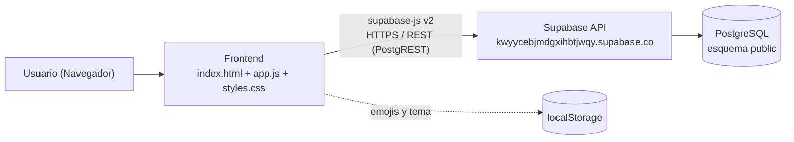
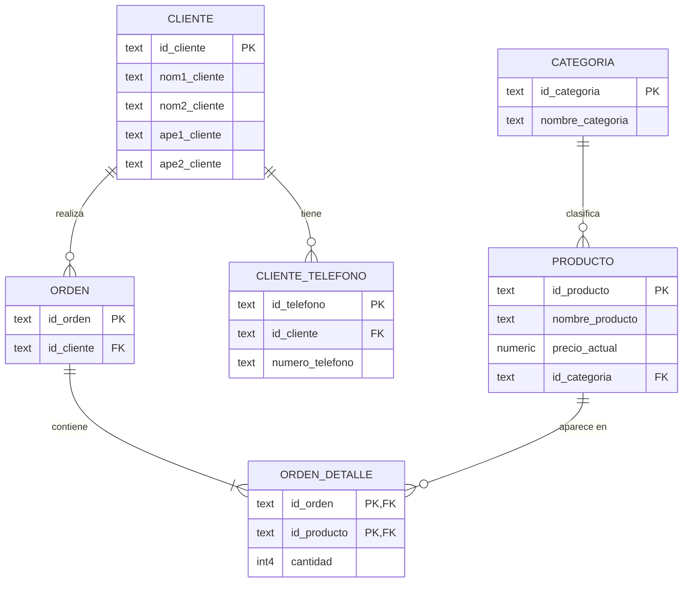
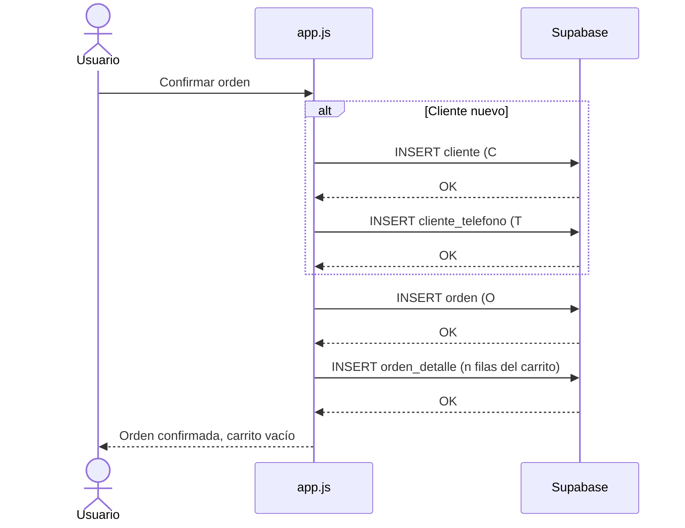

# 📘 Documentación de Base de Datos — Vantage Sport

| Campo | Valor |
|---|---|
| **Proyecto** | Vantage Sport — Tienda deportiva con panel CRUD |
| **Motor** | PostgreSQL (gestionado por **Supabase**) |
| **Proyecto Supabase** | `kwyycebjmdgxihbtjwqy` |
| **Esquema** | `public` |
| **Cliente de acceso** | `@supabase/supabase-js` v2 (CDN) |
| **Versión del documento** | 1.0 |
| **Fecha** | 22/10/2026 |

---

## Índice

1. [Descripción general](#1-descripción-general)
2. [Arquitectura](#2-arquitectura)
3. [Conexión a la base de datos](#3-conexión-a-la-base-de-datos)
4. [Modelo Entidad-Relación](#4-modelo-entidad-relación)
5. [Diccionario de datos](#5-diccionario-de-datos)
6. [Relaciones y cardinalidad](#6-relaciones-y-cardinalidad)
7. [Script DDL (creación de tablas)](#7-script-ddl-creación-de-tablas)
8. [Convención de identificadores](#8-convención-de-identificadores)
9. [Operaciones CRUD desde la aplicación](#9-operaciones-crud-desde-la-aplicación)
10. [Flujo de compra (checkout)](#10-flujo-de-compra-checkout)
11. [Manejo de errores](#11-manejo-de-errores)
12. [Seguridad](#12-seguridad)
13. [Consultas SQL útiles](#13-consultas-sql-útiles)
14. [Datos de ejemplo](#14-datos-de-ejemplo)
15. [Respaldo y mantenimiento](#15-respaldo-y-mantenimiento)

---

## 1. Descripción general

La base de datos de **Vantage Sport** gestiona la información de una tienda en línea:

- **Catálogo**: categorías y productos con su precio actual.
- **Clientes**: datos personales y uno o varios teléfonos de contacto.
- **Ventas**: órdenes de compra (cabecera) y sus líneas de detalle (productos y cantidades).

La aplicación web (`index.html` + `app.js`) se conecta directamente a Supabase desde el navegador, carga todas las tablas al iniciar y permite:

- Navegar el catálogo y comprar (tienda + carrito).
- Consultar órdenes registradas.
- Administrar todas las tablas mediante un panel **CRUD** (crear, leer, actualizar, eliminar).

---

## 2. Arquitectura



| Capa | Tecnología | Responsabilidad |
|---|---|---|
| Presentación | HTML, CSS, JavaScript (vanilla) | Interfaz de tienda, carrito, órdenes y panel admin |
| Acceso a datos | `supabase-js` v2 | Traduce `.from().select/insert/update/delete` a peticiones REST |
| API | Supabase (PostgREST) | Expone las tablas como endpoints REST, aplica RLS |
| Persistencia | PostgreSQL | Almacena los datos y valida PK / FK |
| Almacenamiento local | `localStorage` | Guarda emojis de productos (`vantage_emojis`) y tema (`vantage_theme`). **No** se guarda en la BD |

---

## 3. Conexión a la base de datos

### 3.1 Librería

Se carga desde CDN en [`index.html`](../index.html):

```html
<script src="https://cdn.jsdelivr.net/npm/@supabase/supabase-js@2"></script>
```

### 3.2 Inicialización del cliente

En [`app.js`](../app.js) (líneas 5–7):

```js
const supabaseUrl = 'https://kwyycebjmdgxihbtjwqy.supabase.co';
const supabaseKey = 'sb_publishable_...';   // Clave pública (publishable / anon)
const sbClient   = window.supabase.createClient(supabaseUrl, supabaseKey);
```

### 3.3 Variables de entorno (`.env`)

El archivo `.env` (excluido de Git mediante `.gitignore`) contiene:

| Variable | Uso | ¿Puede ir en el frontend? |
|---|---|---|
| `SUPABASE_URL` | URL del proyecto Supabase | ✅ Sí |
| `SUPABASE_ANON_KEY` | Clave pública / anónima. Sujeta a políticas RLS | ✅ Sí |
| `SUPABASE_SERVICE_ROLE_KEY` | Clave con privilegios totales (ignora RLS) | ❌ **Nunca** |

> ⚠️ Actualmente la URL y la clave pública están escritas directamente en `app.js`. Como el proyecto es HTML estático (sin bundler), el `.env` no se lee automáticamente. Ver [sección 12](#12-seguridad).

### 3.4 Carga inicial de datos

Al iniciar (`init()` → `reloadDB()`), la app consulta las 6 tablas en orden y guarda los resultados en memoria (objeto `db`):

```js
const tablas = ['categoria', 'producto', 'cliente', 'cliente_telefono', 'orden', 'orden_detalle'];
for (const t of tablas) {
  const { data, error } = await sbClient.from(t).select('*');
  if (!error) db[t] = data;
}
```

El indicador **"Supabase DB"** en la cabecera muestra el estado de la conexión, y el botón **🔄 Sincronizar con Supabase** del panel admin vuelve a ejecutar `reloadDB()`.

### 3.5 Conexión directa (herramientas externas)

Para conectarse con pgAdmin, DBeaver, `psql`, etc., usar los datos de **Supabase → Project Settings → Database → Connection string**:

```
Host:     db.kwyycebjmdgxihbtjwqy.supabase.co
Puerto:   5432 (directo) / 6543 (pooler)
Base:     postgres
Usuario:  postgres
Password: <contraseña de la base de datos del proyecto>
SSL:      requerido
```

---

## 4. Modelo Entidad-Relación



---

## 5. Diccionario de datos

> **Leyenda:** PK = Clave primaria · FK = Clave foránea · NN = No nulo

### 5.1 `categoria`
Clasificación de los productos de la tienda.

| Columna | Tipo | Restricciones | Descripción | Ejemplo |
|---|---|---|---|---|
| `id_categoria` | `text` | PK, NN | Código único de la categoría | `CAT01` |
| `nombre_categoria` | `text` | NN | Nombre visible de la categoría | `Deportes` |

### 5.2 `producto`
Artículos disponibles para la venta.

| Columna | Tipo | Restricciones | Descripción | Ejemplo |
|---|---|---|---|---|
| `id_producto` | `text` | PK, NN | Código único del producto | `P007` |
| `nombre_producto` | `text` | NN | Nombre comercial | `Balón de Fútbol Pro` |
| `precio_actual` | `numeric` | NN, ≥ 0 | Precio de venta vigente | `29.99` |
| `id_categoria` | `text` | FK → `categoria.id_categoria`, NN | Categoría a la que pertenece | `CAT01` |

### 5.3 `cliente`
Personas que realizan compras.

| Columna | Tipo | Restricciones | Descripción | Ejemplo |
|---|---|---|---|---|
| `id_cliente` | `text` | PK, NN | Código único del cliente | `C001` |
| `nom1_cliente` | `text` | NN | Primer nombre | `Juan` |
| `nom2_cliente` | `text` | Opcional | Segundo nombre | `Carlos` |
| `ape1_cliente` | `text` | NN | Primer apellido | `Pérez` |
| `ape2_cliente` | `text` | Opcional | Segundo apellido | `Gómez` |

### 5.4 `cliente_telefono`
Teléfonos de contacto (un cliente puede tener varios). Tabla resultante de normalizar el atributo multivaluado "teléfono".

| Columna | Tipo | Restricciones | Descripción | Ejemplo |
|---|---|---|---|---|
| `id_telefono` | `text` | PK, NN | Código único del teléfono | `T001` |
| `id_cliente` | `text` | FK → `cliente.id_cliente`, NN | Cliente dueño del número | `C001` |
| `numero_telefono` | `text` | NN | Número telefónico | `+56 9 8765 4321` |

### 5.5 `orden`
Cabecera de cada compra.

| Columna | Tipo | Restricciones | Descripción | Ejemplo |
|---|---|---|---|---|
| `id_orden` | `text` | PK, NN | Código único de la orden | `O001` |
| `id_cliente` | `text` | FK → `cliente.id_cliente`, NN | Cliente que realizó la compra | `C001` |

### 5.6 `orden_detalle`
Líneas de cada orden (tabla intermedia N:M entre `orden` y `producto`).

| Columna | Tipo | Restricciones | Descripción | Ejemplo |
|---|---|---|---|---|
| `id_orden` | `text` | PK (compuesta), FK → `orden.id_orden` | Orden a la que pertenece la línea | `O001` |
| `id_producto` | `text` | PK (compuesta), FK → `producto.id_producto` | Producto comprado | `P007` |
| `cantidad` | `int4` | NN, > 0 | Unidades compradas | `2` |

**Campos calculados (no almacenados)** — los calcula `app.js`:

| Cálculo | Fórmula |
|---|---|
| Subtotal de línea | `producto.precio_actual × orden_detalle.cantidad` |
| Total de la orden | `Σ subtotales de la orden` |
| Unidades de la orden | `Σ cantidad` |
| Nombre completo del cliente | `nom1 + nom2 + ape1 + ape2` (omitiendo vacíos) |

---

## 6. Relaciones y cardinalidad

| # | Tabla origen (FK) | Tabla destino (PK) | Cardinalidad | Descripción |
|---|---|---|---|---|
| R1 | `producto.id_categoria` | `categoria.id_categoria` | N : 1 | Cada producto pertenece a una categoría; una categoría tiene 0..N productos |
| R2 | `cliente_telefono.id_cliente` | `cliente.id_cliente` | N : 1 | Un cliente tiene 0..N teléfonos |
| R3 | `orden.id_cliente` | `cliente.id_cliente` | N : 1 | Un cliente realiza 0..N órdenes |
| R4 | `orden_detalle.id_orden` | `orden.id_orden` | N : 1 | Una orden tiene 1..N líneas |
| R5 | `orden_detalle.id_producto` | `producto.id_producto` | N : 1 | Un producto aparece en 0..N líneas |

**Normalización:** el modelo cumple **3FN** — no hay atributos multivaluados (teléfonos separados), no hay dependencias parciales (`cantidad` depende de la clave compuesta completa) ni transitivas.

---

## 7. Script DDL (creación de tablas)


```sql
-- =====================================================
--  Vantage Sport - Esquema de base de datos
-- =====================================================

-- 1. Categoría
CREATE TABLE public.categoria (
    id_categoria     TEXT PRIMARY KEY,
    nombre_categoria TEXT NOT NULL
);

-- 2. Producto
CREATE TABLE public.producto (
    id_producto     TEXT PRIMARY KEY,
    nombre_producto TEXT    NOT NULL,
    precio_actual   NUMERIC NOT NULL CHECK (precio_actual >= 0),
    id_categoria    TEXT    NOT NULL
        REFERENCES public.categoria (id_categoria)
        ON UPDATE CASCADE ON DELETE RESTRICT
);

-- 3. Cliente
CREATE TABLE public.cliente (
    id_cliente   TEXT PRIMARY KEY,
    nom1_cliente TEXT NOT NULL,
    nom2_cliente TEXT,
    ape1_cliente TEXT NOT NULL,
    ape2_cliente TEXT
);

-- 4. Teléfonos del cliente
CREATE TABLE public.cliente_telefono (
    id_telefono     TEXT PRIMARY KEY,
    id_cliente      TEXT NOT NULL
        REFERENCES public.cliente (id_cliente)
        ON UPDATE CASCADE ON DELETE RESTRICT,
    numero_telefono TEXT NOT NULL
);

-- 5. Orden (cabecera)
CREATE TABLE public.orden (
    id_orden   TEXT PRIMARY KEY,
    id_cliente TEXT NOT NULL
        REFERENCES public.cliente (id_cliente)
        ON UPDATE CASCADE ON DELETE RESTRICT
);

-- 6. Detalle de la orden
CREATE TABLE public.orden_detalle (
    id_orden    TEXT NOT NULL
        REFERENCES public.orden (id_orden)
        ON UPDATE CASCADE ON DELETE RESTRICT,
    id_producto TEXT NOT NULL
        REFERENCES public.producto (id_producto)
        ON UPDATE CASCADE ON DELETE RESTRICT,
    cantidad    INT4 NOT NULL CHECK (cantidad > 0),
    PRIMARY KEY (id_orden, id_producto)
);

-- Índices sobre claves foráneas (mejoran los JOIN)
CREATE INDEX idx_producto_categoria   ON public.producto (id_categoria);
CREATE INDEX idx_telefono_cliente     ON public.cliente_telefono (id_cliente);
CREATE INDEX idx_orden_cliente        ON public.orden (id_cliente);
CREATE INDEX idx_detalle_producto     ON public.orden_detalle (id_producto);
```

**Eliminación (orden inverso):**

```sql
DROP TABLE IF EXISTS public.orden_detalle, public.orden,
                     public.cliente_telefono, public.cliente,
                     public.producto, public.categoria CASCADE;
```

---

## 8. Convención de identificadores

Los IDs son de tipo `text` y los genera el **frontend** con la función `nextId()` de `app.js` (toma el número mayor existente y suma 1).

| Tabla | Prefijo | Relleno | Ejemplo |
|---|---|---|---|
| `categoria` | `CAT` | 2 dígitos | `CAT01`, `CAT02` |
| `producto` | `P` | 3 dígitos | `P001`, `P012` |
| `cliente` | `C` | 3 dígitos | `C001` |
| `cliente_telefono` | `T` | 3 dígitos | `T001` |
| `orden` | `O` | 3 dígitos | `O001` |
| `orden_detalle` | — | Clave compuesta `(id_orden, id_producto)` | `(O001, P007)` |

---

## 9. Operaciones CRUD desde la aplicación

Configuradas en `TABLE_CONFIG` y ejecutadas por `submitCrudForm()` y `executeDelete()` en `app.js`.

| Operación | Código supabase-js | SQL equivalente |
|---|---|---|
| **Leer** | `sbClient.from(t).select('*')` | `SELECT * FROM t;` |
| **Crear** | `sbClient.from(t).insert([payload]).select()` | `INSERT INTO t (...) VALUES (...) RETURNING *;` |
| **Actualizar** | `sbClient.from(t).update(payload).eq(idKey, id).select()` | `UPDATE t SET ... WHERE idKey = id RETURNING *;` |
| **Eliminar** | `sbClient.from(t).delete().eq(idKey, id)` | `DELETE FROM t WHERE idKey = id;` |

Para `orden_detalle` (clave compuesta) se encadenan dos filtros:

```js
sbClient.from('orden_detalle')
  .update(payload)
  .eq('id_orden', idOrden)
  .eq('id_producto', idProducto);
```

---

## 10. Flujo de compra (checkout)

Función `checkout()` en `app.js`. Inserta en hasta 4 tablas:



> ⚠️ Las inserciones son independientes (no hay transacción). Si falla un paso intermedio, pueden quedar registros parciales (por ejemplo, una `orden` sin detalle). Ver [sección 16](#16-observaciones-y-mejoras-recomendadas).

---

## 11. Manejo de errores

Códigos de PostgreSQL interpretados por la aplicación:

| Código | Significado | Mensaje mostrado al usuario |
|---|---|---|
| `23505` | `unique_violation` — PK o clave única duplicada | "Ya existe un registro con ese ID o clave única." |
| `23503` | `foreign_key_violation` — FK inexistente o registro con dependencias | "Error de relación…" / "Restricción de Integridad: este registro está vinculado a otros datos…" |
| Otro | Error de red, RLS, etc. | `err.message` o mensaje genérico |

**Orden de borrado para respetar la integridad referencial:**

```
orden_detalle → orden → cliente_telefono → cliente
orden_detalle → producto → categoria
```

---

## 12. Seguridad

### 12.1 Claves
- ✅ `.env` está en `.gitignore`.
- ✅ El frontend usa la clave **pública** (`sb_publishable_…`), que está diseñada para exponerse en el navegador.
- ❌ La `SUPABASE_SERVICE_ROLE_KEY` **nunca** debe aparecer en `app.js` ni en ningún archivo público.
- ⚠️ La clave pública está escrita en `app.js` (versionado en Git). Es aceptable **solo si RLS está activo**.

### 12.2 Row Level Security (RLS)
Con la clave pública, **la única protección real de los datos son las políticas RLS**. Recomendación mínima:

```sql
-- Activar RLS en todas las tablas
ALTER TABLE public.categoria        ENABLE ROW LEVEL SECURITY;
ALTER TABLE public.producto         ENABLE ROW LEVEL SECURITY;
ALTER TABLE public.cliente          ENABLE ROW LEVEL SECURITY;
ALTER TABLE public.cliente_telefono ENABLE ROW LEVEL SECURITY;
ALTER TABLE public.orden            ENABLE ROW LEVEL SECURITY;
ALTER TABLE public.orden_detalle    ENABLE ROW LEVEL SECURITY;

-- Catálogo: lectura pública
CREATE POLICY "Lectura pública categorías" ON public.categoria FOR SELECT USING (true);
CREATE POLICY "Lectura pública productos"  ON public.producto  FOR SELECT USING (true);

-- Escritura solo para usuarios autenticados (panel admin)
CREATE POLICY "Admin gestiona productos" ON public.producto
    FOR ALL TO authenticated USING (true) WITH CHECK (true);
```

> ⚠️ Hoy la app no tiene inicio de sesión: cualquier visitante puede usar el panel CRUD. Si RLS permite todo al rol `anon`, **cualquiera con la URL puede leer y modificar todos los datos**, incluidos los datos personales de clientes.

---

## 13. Consultas SQL útiles

**Catálogo con categoría:**
```sql
SELECT p.id_producto, p.nombre_producto, p.precio_actual, c.nombre_categoria
FROM producto p
JOIN categoria c ON c.id_categoria = p.id_categoria
ORDER BY c.nombre_categoria, p.nombre_producto;
```

**Total por orden:**
```sql
SELECT o.id_orden,
       CONCAT_WS(' ', cl.nom1_cliente, cl.ape1_cliente) AS cliente,
       SUM(d.cantidad)                   AS unidades,
       SUM(d.cantidad * p.precio_actual) AS total
FROM orden o
JOIN cliente cl       ON cl.id_cliente = o.id_cliente
JOIN orden_detalle d  ON d.id_orden    = o.id_orden
JOIN producto p       ON p.id_producto = d.id_producto
GROUP BY o.id_orden, cliente
ORDER BY o.id_orden;
```

**Clientes con sus teléfonos:**
```sql
SELECT c.id_cliente,
       CONCAT_WS(' ', c.nom1_cliente, c.nom2_cliente, c.ape1_cliente, c.ape2_cliente) AS nombre,
       STRING_AGG(t.numero_telefono, ', ') AS telefonos
FROM cliente c
LEFT JOIN cliente_telefono t ON t.id_cliente = c.id_cliente
GROUP BY c.id_cliente;
```

**Productos más vendidos:**
```sql
SELECT p.nombre_producto, SUM(d.cantidad) AS vendidos
FROM orden_detalle d
JOIN producto p ON p.id_producto = d.id_producto
GROUP BY p.nombre_producto
ORDER BY vendidos DESC
LIMIT 5;
```

**Ventas por categoría:**
```sql
SELECT c.nombre_categoria, SUM(d.cantidad * p.precio_actual) AS ingresos
FROM orden_detalle d
JOIN producto  p ON p.id_producto  = d.id_producto
JOIN categoria c ON c.id_categoria = p.id_categoria
GROUP BY c.nombre_categoria
ORDER BY ingresos DESC;
```

---

## 14. Datos de ejemplo

```sql
INSERT INTO categoria VALUES
  ('CAT01', 'Electrónica'), ('CAT02', 'Hogar'),
  ('CAT03', 'Deportes'),    ('CAT04', 'Libros');

INSERT INTO producto VALUES
  ('P001', 'Audífonos Inalámbricos', 59.99, 'CAT01'),
  ('P007', 'Balón de Fútbol Pro',    29.99, 'CAT03'),
  ('P009', 'Zapatillas Running',     89.90, 'CAT03');

INSERT INTO cliente VALUES
  ('C001', 'Juan', 'Carlos', 'Pérez', 'Gómez');

INSERT INTO cliente_telefono VALUES
  ('T001', 'C001', '+56 9 8765 4321');

INSERT INTO orden VALUES ('O001', 'C001');

INSERT INTO orden_detalle VALUES
  ('O001', 'P007', 2),
  ('O001', 'P009', 1);
```

---

## 15. Respaldo y mantenimiento

| Tarea | Cómo |
|---|---|
| Respaldo automático | Supabase → **Database → Backups** (diario en planes pagos) |
| Respaldo manual | `pg_dump "postgresql://postgres:<PASSWORD>@db.kwyycebjmdgxihbtjwqy.supabase.co:5432/postgres" -n public -f backup_vantage.sql` |
| Restaurar | `psql "<cadena_conexion>" -f backup_vantage.sql` |
| Exportar una tabla | Table Editor → tabla → **Export to CSV** |
| Ver logs | Supabase → **Logs → API / Postgres** |
| Plan gratuito | El proyecto se **pausa** tras 7 días sin actividad; reactivarlo desde el dashboard |

---


