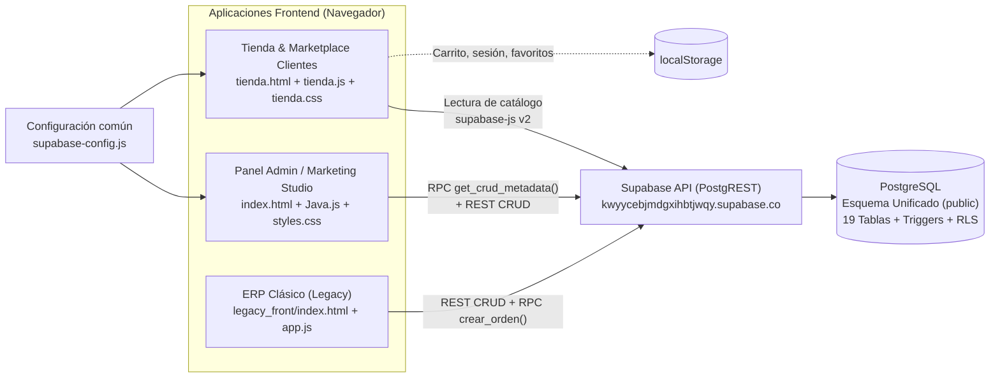
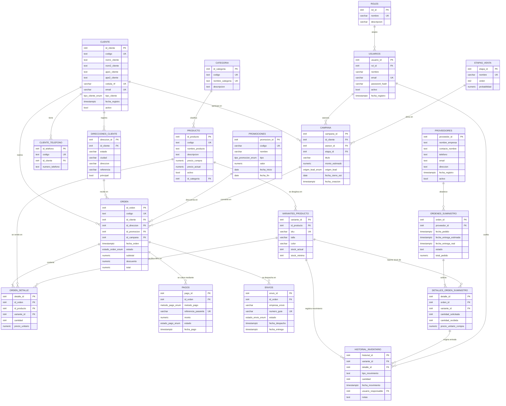
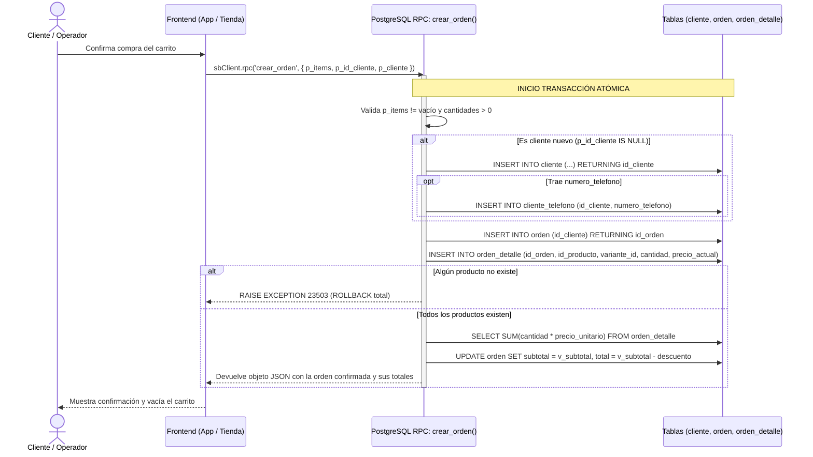

# 📘 Documentación de Base de Datos Unificada — Vantage Sport

| Campo | Valor |
|---|---|
| **Proyecto** | Vantage Sport — Ecosistema Deportivo Unificado (ERP + Ventas/CRM + Marketplace + Logística + Suministros) |
| **Motor** | PostgreSQL (gestionado por **Supabase**) |
| **Proyecto Supabase** | `kwyycebjmdgxihbtjwqy` |
| **Esquema** | `public` (19 tablas + 7 tipos ENUM + 2 funciones RPC/Trigger) |
| **Cliente de acceso** | `@supabase/supabase-js` v2 (CDN) |
| **Versión del documento** | 2.0 (Esquema Unificado) |
| **Fecha** | 05/11/2026 |

---

## Índice

1. [Descripción general y contexto del negocio](#1-descripción-general-y-contexto-del-negocio)
2. [Arquitectura del sistema](#2-arquitectura-del-sistema)
3. [Conexión a la base de datos e introspección](#3-conexión-a-la-base-de-datos-e-introspección)
4. [Modelo Entidad-Relación (ER)](#4-modelo-entidad-relación-er)
5. [Tipos de datos personalizados (ENUMs)](#5-tipos-de-datos-personalizados-enums)
6. [Diccionario de datos (19 tablas)](#6-diccionario-de-datos-19-tablas)
7. [Relaciones, integridad referencial y normalización](#7-relaciones-integridad-referencial-y-normalización)
8. [Convención de identificadores y trazabilidad](#8-convención-de-identificadores-y-trazabilidad)
9. [Funciones de negocio y Triggers (PL/pgSQL)](#9-funciones-de-negocio-y-triggers-plpgsql)
10. [Operaciones CRUD desde las aplicaciones](#10-operaciones-crud-desde-las-aplicaciones)
11. [Flujo de compra y creación transaccional de órdenes](#11-flujo-de-compra-y-creación-transaccional-de-órdenes)
12. [Manejo de errores](#12-manejo-de-errores)
13. [Seguridad y políticas RLS](#13-seguridad-y-políticas-rls)
14. [Script DDL de referencia](#14-script-ddl-de-referencia)
15. [Consultas SQL útiles (Reportes y Analítica)](#15-consultas-sql-útiles-reportes-y-analítica)
16. [Datos de ejemplo (Seed Unificado)](#16-datos-de-ejemplo-seed-unificado)
17. [Respaldo y mantenimiento](#17-respaldo-y-mantenimiento)

---

## 1. Descripción general y contexto del negocio

### ¿Qué es Vantage Sport?
**Vantage Sport** es una marca y plataforma de comercio deportivo de alto rendimiento (*fútbol, running, training, abrigo técnico y accesorios*). Para evitar islas de información entre departamentos, la plataforma opera sobre una **Base de Datos Unificada** que centraliza todas las áreas operativas del negocio en un único esquema relacional en PostgreSQL (Supabase).

Cualquier persona que se incorpore al proyecto debe entender que esta base de datos responde a **7 módulos funcionales integrados**:

1. **Seguridad y Usuarios (`roles`, `usuarios`)**: Control de acceso del personal interno (administradores, asesores comerciales y especialistas de marketing).
2. **Catálogo e Inventario Base (`categoria`, `producto`, `variantes_producto`)**: Clasificación de artículos deportivos, precios de costo y venta, y desglose físico por SKU, talla, color, stock disponible y stock mínimo de alerta.
3. **Comunidad de Clientes (`cliente`, `cliente_telefono`, `direcciones_cliente`)**: Registro de compradores minoristas (atletas individuales) y mayoristas (clubes deportivos, gimnasios), con soporte para múltiples teléfonos y libreta de direcciones de envío.
4. **Ventas y CRM (`promociones`, `etapas_venta`, `campana`)**: Gestión del embudo comercial (*pipeline* de ventas B2B/B2C), asignación de asesores a oportunidades (campañas) y cupones de descuento por porcentaje o monto fijo.
5. **Órdenes y Pedidos (`orden`, `orden_detalle`)**: Cabecera y líneas de cada venta realizada, vinculando al cliente, su dirección de despacho, la promoción aplicada, la campaña de origen y el precio unitario histórico congelado al momento de la compra.
6. **Pagos y Logística (`pagos`, `envios`)**: Registro de cobros multi-método (tarjeta, transferencia, pago móvil, Zelle, PayPal, efectivo) y seguimiento de despachos con empresas transportistas y números de guía.
7. **Suministros y Kardex de Inventario (`proveedores`, `ordenes_suministro`, `detalles_orden_suministro`, `historial_inventario`)**: Abastecimiento con fábricas y proveedores externos, órdenes de compra de reposición y auditoría de cada entrada/salida de stock.

### Consolidación de módulos (Historia de la unificación)
Originalmente existían esquemas separados para el ERP básico, el módulo de CRM/Marketing y el módulo de Suministros. El esquema actual ([`database/esquema_unificado.sql`](../database/esquema_unificado.sql)) los fusionó bajo las siguientes reglas:

| Tabla Unificada Actual | Tablas / Orígenes que absorbió | Beneficio principal |
|---|---|---|
| `categoria` | `categoria` (ERP) + `categorias` (Suministros) | Un único árbol de categorías con código y descripción |
| `producto` | `producto` (ERP) + `productos` (CRM) + `productos` (Suministros) | Reúne `precio_compra` (costo) y `precio_actual` (venta) en un solo registro |
| `variantes_producto` | `variantes_producto` (CRM + Suministros) | Control exacto de tallas, colores, `sku`, `stock_actual` y `stock_minimo` |
| `cliente` | `cliente` (ERP) + `clientes` (CRM) | Mantiene nombres desglosados y añade `cedula_rif`, `email` y `tipo_cliente` |
| `cliente_telefono` | `cliente_telefono` (ERP) + `clientes.telefono` | Normalización en 3FN permitiendo múltiples teléfonos por cliente |
| `orden` | `orden` (ERP) + `pedidos` (CRM) | Añade estados, fechas, subtotal, descuento, total y enlaces a CRM y dirección |
| `orden_detalle` | `orden_detalle` (ERP) + `detalle_pedido` (CRM) | Permite vender productos base o variantes específicas guardando el `precio_unitario` |

---

## 2. Arquitectura del sistema

El ecosistema cuenta con tres interfaces web que consumen la misma base de datos en Supabase:



| Capa / Componente | Archivos principales | Responsabilidad |
|---|---|---|
| **Panel Admin & Marketing Studio** | [`index.html`](../index.html), [`Java.js`](../Java.js), [`styles.css`](../styles.css) | Panel administrativo dinámico que auto-descubre el esquema mediante `get_crud_metadata()` y gestiona campañas, clientes, envíos, pedidos, productos y promociones. |
| **Tienda Oficial (Marketplace)** | [`tienda.html`](../tienda.html), [`tienda.js`](../tienda.js), [`tienda.css`](../tienda.css) | Experiencia de compra para clientes estilo Mercado Libre: buscador tolerante a acentos, filtros por talla/deporte/precio, comparador de prendas, preguntas al vendedor y carrito. |
| **ERP Clásico (Legacy)** | [`legacy_front/index.html`](../legacy_front/index.html), [`legacy_front/app.js`](../legacy_front/app.js) | Primera versión del punto de venta y panel CRUD de las 6 tablas originales. Conservada como referencia histórica. |
| **Configuración de cliente** | [`supabase-config.js`](../supabase-config.js) | Centraliza `SUPABASE_URL` y `SUPABASE_PUBLISHABLE_KEY` en `window.VANTAGE_CONFIG`. |
| **Capa de Datos y Negocio** | [`database/esquema_unificado.sql`](../database/esquema_unificado.sql), [`database/get_crud_metadata.sql`](../database/get_crud_metadata.sql) | Tablas PostgreSQL, tipos ENUM, índices, políticas RLS, trigger de precios y funciones RPC (`crear_orden`, `get_crud_metadata`). |

---

## 3. Conexión a la base de datos e introspección

### 3.1 Librería y archivo de configuración

Tanto el panel administrativo (`index.html`) como la tienda (`tienda.html`) cargan el SDK oficial de Supabase v2 desde CDN y leen las credenciales públicas desde [`supabase-config.js`](../supabase-config.js):

```html
<script src="https://cdn.jsdelivr.net/npm/@supabase/supabase-js@2"></script>
<script src="supabase-config.js"></script>
```

Contenido de [`supabase-config.js`](../supabase-config.js):

```js
window.VANTAGE_CONFIG = {
  SUPABASE_URL: 'https://kwyycebjmdgxihbtjwqy.supabase.co',
  SUPABASE_PUBLISHABLE_KEY: 'sb_publishable_XWP4yM1-sYMwkJN5s6_I3w_gWDq6gNr'
};
```

### 3.2 Variables de entorno (`.env`)

El archivo `.env` (excluido de Git mediante [`.gitignore`](../.gitignore)) almacena las credenciales para scripts locales o herramientas de backend:

| Variable | Uso | ¿Puede ir en el frontend? |
|---|---|---|
| `SUPABASE_URL` | URL del endpoint del proyecto Supabase | ✅ Sí |
| `SUPABASE_ANON_KEY` / `PUBLISHABLE_KEY` | Clave pública anónima. Sujeta siempre a políticas RLS | ✅ Sí |
| `SUPABASE_SERVICE_ROLE_KEY` | Clave maestra administrativa (salta todas las políticas RLS) | ❌ **Nunca** |

### 3.3 Carga dinámica por introspección (`Java.js`)

A diferencia de las aplicaciones tradicionales que tienen las columnas codificadas de forma fija en el frontend, el **Panel Admin (`Java.js`)** interroga a la base de datos al iniciar mediante la función RPC `get_crud_metadata()`:

```js
const { data, error } = await state.client.rpc('get_crud_metadata');
state.schema = data; // Diccionario con todas las tablas, columnas, PKs, FKs y ENUMs
```

Con esta respuesta JSON, el frontend construye automáticamente las cabeceras de las tablas, los formularios modales de creación/edición, los selectores desplegables de claves foráneas (`<select>`) y las listas de valores ENUM sin necesidad de reprogramar la interfaz si se añade una columna en SQL.

### 3.4 Conexión directa (Herramientas SQL externas)

Para conectarse mediante DBeaver, pgAdmin, DataGrip o `psql`, obtener la cadena en **Supabase Dashboard → Project Settings → Database**:

```text
Host:     db.kwyycebjmdgxihbtjwqy.supabase.co
Puerto:   5432 (conexión directa) / 6543 (connection pooler Supavisor)
Base:     postgres
Usuario:  postgres
Password: <contraseña del proyecto en Supabase>
SSL:      requerido (sslmode=require)
```

---

## 4. Modelo Entidad-Relación (ER)

El esquema consta de **19 tablas** interconectadas. A continuación se presenta el diagrama Entidad-Relación completo:



---

## 5. Tipos de datos personalizados (ENUMs)

Para garantizar la consistencia de los datos y evitar errores de tipeo en estados, métodos o clasificaciones, el esquema define **7 tipos enumerados (`ENUM`)** nativos en PostgreSQL:

| Nombre del ENUM | Valores permitidos | Tabla y columna donde se usa | Propósito de negocio |
|---|---|---|---|
| `estado_orden_enum` | `'pendiente'`, `'pagado'`, `'enviado'`, `'entregado'`, `'cancelado'` | `orden.estado` | Ciclo de vida del pedido del cliente desde que se crea hasta su entrega o anulación. |
| `metodo_pago_enum` | `'efectivo'`, `'transferencia'`, `'pago_movil'`, `'tarjeta'`, `'zelle'`, `'paypal'` | `pagos.metodo_pago` | Instrumento financiero empleado por el comprador para abonar la orden. |
| `estado_pago_enum` | `'pendiente'`, `'confirmado'`, `'rechazado'`, `'reembolsado'` | `pagos.estado` | Estado de conciliación bancaria o validación de la pasarela de pago. |
| `estado_envio_enum` | `'preparando'`, `'despachado'`, `'en_transito'`, `'entregado'`, `'devuelto'` | `envios.estado` | Trazabilidad logística del paquete con la empresa de encomiendas. |
| `tipo_promocion_enum` | `'porcentaje'`, `'monto_fijo'` | `promociones.tipo` | Define si el campo `valor` de la promoción resta un `%` (ej. 20%) o un monto fijo en dólares (ej. $10). |
| `tipo_cliente_enum` | `'minorista'`, `'mayorista'` | `cliente.tipo_cliente` | Segmenta entre consumidores finales (atletas) y compradores corporativos (clubes, gimnasios). |
| `origen_lead_enum` | `'web'`, `'redes_sociales'`, `'referido'`, `'tienda_fisica'`, `'otro'` | `campana.origen_lead` | Canal de atribución de marketing por el cual llegó la oportunidad comercial. |

> 💡 **Ampliación de valores:** Si en el futuro se requiere agregar un nuevo valor a un ENUM sin recrear las tablas, ejecutar:
> `ALTER TYPE metodo_pago_enum ADD VALUE 'criptomoneda';`

---

## 6. Diccionario de datos (19 tablas)

> **Leyenda:** `PK` = Clave primaria (`GENERATED ALWAYS AS IDENTITY`) · `FK` = Clave foránea · `UK` = Clave única (`UNIQUE`) · `NN` = No nulo (`NOT NULL`)

---

### Módulo 1: Seguridad y Usuarios

#### 6.1 `roles`
Define los perfiles de acceso y responsabilidades dentro de la organización.

| Columna | Tipo | Restricciones | Descripción | Ejemplo |
|---|---|---|---|---|
| `rol_id` | `int4` | PK, Identity, NN | Identificador único autoincremental del rol | `1` |
| `nombre` | `varchar` | UK, NN | Nombre técnico del rol | `'admin'`, `'asesor'`, `'marketing'` |
| `descripcion` | `varchar` | Opcional | Explicación del alcance del rol | `'Asesor comercial de marketing y ventas'` |

#### 6.2 `usuarios`
Personal interno de Vantage Sport (administradores, asesores de ventas y gestores de inventario).

| Columna | Tipo | Restricciones | Descripción | Ejemplo |
|---|---|---|---|---|
| `usuario_id` | `int4` | PK, Identity, NN | Identificador único del usuario interno | `2` |
| `rol_id` | `int4` | FK → `roles.rol_id`, NN | Rol asignado al usuario | `2` |
| `nombre` | `varchar` | NN | Nombre completo del colaborador | `'Carlos Mendoza (Asesor Senior)'` |
| `email` | `varchar` | UK, NN | Correo corporativo de acceso | `'carlos.mendoza@vantage.com'` |
| `password_hash` | `varchar` | NN | Hash criptográfico de la contraseña (bcrypt) | `'$2a$12$e8y..mockAdvisorHash1'` |
| `activo` | `bool` | NN, Default `true` | Indica si la cuenta está habilitada | `true` |
| `fecha_registro` | `timestamptz` | NN, Default `now()` | Fecha y hora de alta del usuario | `'2026-10-29 21:00:00-04'` |

---

### Módulo 2: Catálogo e Inventario Base

#### 6.3 `categoria`
Clasificación principal de las líneas deportivas de la tienda.

| Columna | Tipo | Restricciones | Descripción | Ejemplo |
|---|---|---|---|---|
| `id_categoria` | `int4` | PK, Identity, NN | Identificador único de la categoría | `1` |
| `codigo` | `text` | UK, Opcional | Código legado de trazabilidad del ERP | `'CAT01'` |
| `nombre_categoria` | `text` | UK, NN | Nombre comercial visible de la categoría | `'Fútbol'` |
| `descripcion` | `text` | Opcional | Detalle de los artículos que agrupa | `'Equipaciones oficiales matchday, camisetas retro...'` |

#### 6.4 `producto`
Catálogo maestro de prendas y artículos deportivos.

| Columna | Tipo | Restricciones | Descripción | Ejemplo |
|---|---|---|---|---|
| `id_producto` | `int4` | PK, Identity, NN | Identificador único del producto | `1` |
| `codigo` | `text` | UK, Opcional | Código legado del ERP | `'P001'` |
| `nombre_producto` | `text` | NN | Nombre comercial del artículo | `'Camiseta Técnica Vantage Pro Matchday Dri-FIT'` |
| `descripcion` | `text` | Opcional | Especificaciones técnicas y materiales | `'Camiseta oficial con microfibras ventiladas...'` |
| `precio_compra` | `numeric(12,2)` | Opcional, `>= 0` | Costo de adquisición con el proveedor | `22.00` |
| `precio_actual` | `numeric(12,2)` | NN, `>= 0` | Precio de venta al público vigente | `49.99` |
| `activo` | `bool` | NN, Default `true` | Si está visible y disponible para la venta | `true` |
| `id_categoria` | `int4` | FK → `categoria.id_categoria` | Categoría deportiva a la que pertenece | `1` |

#### 6.5 `variantes_producto`
Desglose físico de cada producto por talla y color, donde se controla el stock real en almacén.

| Columna | Tipo | Restricciones | Descripción | Ejemplo |
|---|---|---|---|---|
| `variante_id` | `int4` | PK, Identity, NN | Identificador único de la variante | `2` |
| `id_producto` | `int4` | FK → `producto.id_producto`, NN | Producto padre al que pertenece | `1` |
| `sku` | `varchar` | UK, NN | Código único de inventario (*Stock Keeping Unit*) | `'VAN-P001-M-BLK'` |
| `talla` | `varchar` | Opcional | Talla de la prenda o calzado | `'M'`, `'42'`, `'Talla 5'` |
| `color` | `varchar` | Opcional | Color o combinación cromática | `'Negro'`, `'Naranja/Negro'` |
| `stock_actual` | `int4` | NN, Default `0`, `>= 0` | Unidades físicas disponibles actualmente | `35` |
| `stock_minimo` | `int4` | NN, Default `0`, `>= 0` | Punto de reorden para alertas de abastecimiento | `5` |

---

### Módulo 3: Comunidad de Clientes

#### 6.6 `cliente`
Personas naturales (atletas) o jurídicas (clubes, gimnasios) que compran o interactúan con Vantage Sport.

| Columna | Tipo | Restricciones | Descripción | Ejemplo |
|---|---|---|---|---|
| `id_cliente` | `int4` | PK, Identity, NN | Identificador único del cliente | `1` |
| `codigo` | `text` | UK, Opcional | Código legado de trazabilidad del ERP | `'C001'` |
| `nom1_cliente` | `text` | NN | Primer nombre del cliente o representante | `'Ignacio'` |
| `nom2_cliente` | `text` | Opcional | Segundo nombre | `'Andrés'` |
| `ape1_cliente` | `text` | NN | Primer apellido | `'Silva'` |
| `ape2_cliente` | `text` | Opcional | Segundo apellido | `'Rojas'` |
| `cedula_rif` | `varchar` | UK, Opcional | Documento de identidad fiscal (RUT / Cédula / RIF) | `'19.456.123-K'` |
| `email` | `varchar` | UK, Opcional | Correo electrónico del cliente | `'ignacio.silva.runner@gmail.com'` |
| `tipo_cliente` | `tipo_cliente_enum` | NN, Default `'minorista'` | Clasificación comercial (`minorista` / `mayorista`) | `'minorista'` |
| `fecha_registro` | `timestamptz` | NN, Default `now()` | Fecha de alta en la comunidad | `'2026-10-29 21:00:00-04'` |
| `activo` | `bool` | NN, Default `true` | Estado activo o inactivo del cliente | `true` |

#### 6.7 `cliente_telefono`
Teléfonos de contacto asociados a un cliente (un cliente puede registrar múltiples números).

| Columna | Tipo | Restricciones | Descripción | Ejemplo |
|---|---|---|---|---|
| `id_telefono` | `int4` | PK, Identity, NN | Identificador único del registro telefónico | `1` |
| `codigo` | `text` | UK, Opcional | Código legado de trazabilidad del ERP | `'T001'` |
| `id_cliente` | `int4` | FK → `cliente.id_cliente`, NN | Cliente titular de la línea | `1` |
| `numero_telefono` | `text` | NN | Número telefónico con código de país | `'+56 9 8456 1234'` |

#### 6.8 `direcciones_cliente`
Libreta de direcciones físicas para el despacho de pedidos de cada cliente.

| Columna | Tipo | Restricciones | Descripción | Ejemplo |
|---|---|---|---|---|
| `direccion_id` | `int4` | PK, Identity, NN | Identificador único de la dirección | `1` |
| `id_cliente` | `int4` | FK → `cliente.id_cliente`, NN | Cliente al que pertenece la dirección | `1` |
| `estado` | `varchar` | NN | Región, estado o provincia | `'Región Metropolitana'` |
| `ciudad` | `varchar` | NN | Ciudad o comuna | `'Santiago'` |
| `direccion` | `varchar` | NN | Calle, número y departamento/oficina | `'Av. Providencia 1240, Depto 604'` |
| `referencia` | `varchar` | Opcional | Punto de referencia para el repartidor | `'Frente a metro Manuel Montt'` |
| `principal` | `bool` | NN, Default `false` | Indica si es la dirección predeterminada de envío | `true` |

---

### Módulo 4: Ventas y CRM (Marketing)

#### 6.9 `promociones`
Campañas de descuento y cupones promocionales aplicables a las órdenes.

| Columna | Tipo | Restricciones | Descripción | Ejemplo |
|---|---|---|---|---|
| `promocion_id` | `int4` | PK, Identity, NN | Identificador único de la promoción | `1` |
| `codigo` | `varchar` | UK, NN | Código del cupón promocional | `'VANTAGE20'` |
| `nombre` | `varchar` | NN | Nombre descriptivo de la oferta | `'Drop 2026 Atletas (20% OFF)'` |
| `tipo` | `tipo_promocion_enum` | NN | Modo de cálculo (`porcentaje` o `monto_fijo`) | `'porcentaje'` |
| `valor` | `numeric(12,2)` | NN, `>= 0` | Magnitud del descuento (ej. `20.00` para 20% o $20) | `20.00` |
| `fecha_inicio` | `date` | NN | Inicio de vigencia de la promoción | `'2026-01-01'` |
| `fecha_fin` | `date` | NN, `>= fecha_inicio` | Fin de vigencia (validado con `CHECK`) | `'2026-12-31'` |

#### 6.10 `etapas_venta`
Fases secuenciales del embudo comercial (*pipeline* CRM) con su probabilidad de conversión.

| Columna | Tipo | Restricciones | Descripción | Ejemplo |
|---|---|---|---|---|
| `etapa_id` | `int4` | PK, Identity, NN | Identificador único de la etapa | `3` |
| `nombre` | `varchar` | UK, NN | Nombre de la fase del embudo | `'Negociación Comercial'` |
| `orden` | `int2` | NN | Posición numérica dentro del flujo (1, 2, 3...) | `3` |
| `probabilidad` | `numeric(5,2)` | NN, `0..100` | Porcentaje estimado de cierre exitoso | `75.00` |

#### 6.11 `campana`
Oportunidades comerciales, activaciones de marketing o negociaciones B2B/B2C seguidas por un asesor.
> 📌 **Nota técnica:** En versiones preliminares se llamaba `"Campaña"`, pero se normalizó a `campana` (sin `ñ` ni mayúsculas) para evitar el uso obligatorio de comillas dobles en SQL y facilitar las llamadas desde la API REST.

| Columna | Tipo | Restricciones | Descripción | Ejemplo |
|---|---|---|---|---|
| `campana_id` | `int4` | PK, Identity, NN | Identificador único de la campaña u oportunidad | `1` |
| `id_cliente` | `int4` | FK → `cliente.id_cliente`, NN | Cliente objetivo de la campaña | `3` |
| `asesor_id` | `int4` | FK → `usuarios.usuario_id`, NN | Asesor o responsable comercial asignado | `1` |
| `etapa_id` | `int4` | FK → `etapas_venta.etapa_id`, NN | Etapa actual en el pipeline de ventas | `3` |
| `titulo` | `varchar` | Opcional | Nombre comercial de la oportunidad o campaña | `'Dotación Deportiva Oficial Club Deportivo Andes 2026'` |
| `monto_estimado` | `numeric(12,2)` | Opcional | Ingreso proyectado si se concreta la venta | `2450.00` |
| `origen_lead` | `origen_lead_enum` | Opcional | Canal de captación del prospecto | `'web'`, `'redes_sociales'` |
| `fecha_cierre_est` | `date` | Opcional | Fecha estimada para concretar el cierre | `'2026-11-15'` |
| `fecha_creacion` | `timestamptz` | NN, Default `now()` | Fecha de apertura de la oportunidad | `'2026-10-29 21:00:00-04'` |

---

### Módulo 5: Órdenes y Pedidos de Venta

#### 6.12 `orden`
Cabecera de cada compra o pedido confirmado por un cliente.

| Columna | Tipo | Restricciones | Descripción | Ejemplo |
|---|---|---|---|---|
| `id_orden` | `int4` | PK, Identity, NN | Identificador único interno de la orden | `1` |
| `codigo` | `text` | UK, Opcional | Código comercial legible del pedido | `'ORD-2026-001'` |
| `id_cliente` | `int4` | FK → `cliente.id_cliente`, NN | Comprador titular del pedido | `1` |
| `id_direccion` | `int4` | FK → `direcciones_cliente.direccion_id` | Dirección de entrega seleccionada | `1` |
| `id_promocion` | `int4` | FK → `promociones.promocion_id` | Cupón o promoción aplicada (si corresponde) | `1` |
| `id_campana` | `int4` | FK → `campana.campana_id` | Campaña de marketing que originó la venta | `NULL` |
| `fecha_orden` | `timestamptz` | NN, Default `now()` | Fecha y hora exacta de emisión del pedido | `'2026-10-27 21:00:00-04'` |
| `estado` | `estado_orden_enum` | NN, Default `'pendiente'` | Estado operativo del pedido | `'entregado'` |
| `subtotal` | `numeric(12,2)` | NN, Default `0`, `>= 0` | Suma de `(cantidad × precio_unitario)` antes de descuentos | `169.89` |
| `descuento` | `numeric(12,2)` | NN, Default `0`, `>= 0` | Monto descontado por promociones | `33.98` |
| `total` | `numeric(12,2)` | NN, Default `0`, `>= 0` | Monto neto final a pagar (`subtotal - descuento`) | `135.91` |

#### 6.13 `orden_detalle`
Líneas de artículos incluidos dentro de una orden de venta.

| Columna | Tipo | Restricciones | Descripción | Ejemplo |
|---|---|---|---|---|
| `detalle_id` | `int4` | PK, Identity, NN | Identificador único de la línea de detalle | `1` |
| `id_orden` | `int4` | FK → `orden.id_orden`, NN | Orden a la que pertenece la línea | `1` |
| `id_producto` | `int4` | FK → `producto.id_producto`, NN | Producto vendido | `4` |
| `variante_id` | `int4` | FK → `variantes_producto.variante_id` | Variante específica (talla/color) despachada | `7` |
| `cantidad` | `int4` | NN, `> 0` | Número de unidades compradas | `1` |
| `precio_unitario` | `numeric(12,2)` | NN, `>= 0` | Precio unitario congelado al momento de la venta | `119.90` |

---

### Módulo 6: Pagos y Envíos (Logística)

#### 6.14 `pagos`
Transacciones de cobro asociadas a una orden de venta (una orden puede tener uno o varios abonos/intentos).

| Columna | Tipo | Restricciones | Descripción | Ejemplo |
|---|---|---|---|---|
| `pago_id` | `int4` | PK, Identity, NN | Identificador único del pago | `1` |
| `id_orden` | `int4` | FK → `orden.id_orden`, NN | Orden que se está pagando | `1` |
| `metodo_pago` | `metodo_pago_enum` | NN | Medio de pago utilizado | `'tarjeta'`, `'zelle'` |
| `referencia_pasarela` | `varchar` | UK, Opcional | Comprobante bancario o ID de transacción externa | `'PAY-TRANS-9812401'` |
| `monto` | `numeric(12,2)` | NN, `>= 0` | Importe abonado en la transacción | `135.91` |
| `estado` | `estado_pago_enum` | NN, Default `'pendiente'` | Estado de verificación del cobro | `'confirmado'` |
| `fecha_pago` | `timestamptz` | Opcional | Fecha y hora en que se procesó el pago | `'2026-10-27 21:05:00-04'` |

#### 6.15 `envios`
Despachos logísticos y seguimiento de paquetería asociados a una orden.

| Columna | Tipo | Restricciones | Descripción | Ejemplo |
|---|---|---|---|---|
| `envio_id` | `int4` | PK, Identity, NN | Identificador único del envío | `1` |
| `id_orden` | `int4` | FK → `orden.id_orden`, NN | Orden que se despacha | `1` |
| `empresa_envio` | `varchar` | NN | Operador logístico o courier | `'Chilexpress'`, `'Starken'` |
| `numero_guia` | `varchar` | UK, Opcional | Código de seguimiento (*tracking number*) | `'CHX-9988112233'` |
| `estado` | `estado_envio_enum` | NN, Default `'preparando'` | Situación actual del paquete | `'entregado'` |
| `fecha_despacho` | `timestamptz` | Opcional | Momento en que se entregó al transportista | `'2026-10-27 22:00:00-04'` |
| `fecha_entrega` | `timestamptz` | Opcional | Momento de recepción por parte del cliente | `'2026-10-28 16:30:00-04'` |

---

### Módulo 7: Suministros, Proveedores e Inventario

#### 6.16 `proveedores`
Empresas fabricantes o distribuidoras que abastecen de mercancía e insumos a Vantage Sport.

| Columna | Tipo | Restricciones | Descripción | Ejemplo |
|---|---|---|---|---|
| `proveedor_id` | `int4` | PK, Identity, NN | Identificador único del proveedor | `1` |
| `nombre_empresa` | `text` | NN | Razón social o nombre comercial del fabricante | `'Textiles Técnicos del Sur SpA'` |
| `contacto_nombre` | `text` | Opcional | Ejecutivo comercial de contacto | `'Rodrigo Valenzuela'` |
| `telefono` | `text` | Opcional | Teléfono de contacto comercial | `'+56 2 2890 1200'` |
| `email` | `text` | Opcional | Correo de pedidos a proveedor | `'contacto@textilestecnicos.cl'` |
| `direccion` | `text` | Opcional | Ubicación de planta o bodega del proveedor | `'Parque Industrial Quilicura Lote 4'` |
| `fecha_registro` | `timestamptz` | NN, Default `now()` | Fecha de homologación del proveedor | `'2026-10-29 21:00:00-04'` |
| `activo` | `bool` | NN, Default `true` | Indica si el proveedor sigue operando con Vantage | `true` |

#### 6.17 `ordenes_suministro`
Órdenes de compra emitidas por Vantage Sport hacia sus proveedores para reponer inventario (no confundir con `orden`, que son ventas a clientes).

| Columna | Tipo | Restricciones | Descripción | Ejemplo |
|---|---|---|---|---|
| `orden_id` | `int4` | PK, Identity, NN | Identificador único de la orden de compra | `1` |
| `proveedor_id` | `int4` | FK → `proveedores.proveedor_id` | Proveedor al que se realiza el pedido | `1` |
| `fecha_pedido` | `timestamptz` | NN, Default `now()` | Fecha de emisión de la orden de suministro | `'2026-10-20 10:00:00-04'` |
| `fecha_entrega_estimada` | `timestamptz` | Opcional | Fecha comprometida por el proveedor | `'2026-10-30 10:00:00-04'` |
| `fecha_entrega_real` | `timestamptz` | Opcional | Fecha efectiva de recepción en bodega | `'2026-10-29 15:00:00-04'` |
| `estado` | `text` | NN, Default `'pendiente'` | Estado de recepción (`pendiente`, `recibido`, `parcial`) | `'recibido'` |
| `total_pedido` | `numeric(12,2)` | NN, Default `0`, `>= 0` | Costo total de la compra al proveedor | `1540.00` |

#### 6.18 `detalles_orden_suministro`
Renglones de cada orden de suministro especificando qué variantes (SKUs) se pidieron y cuántas llegaron realmente.

| Columna | Tipo | Restricciones | Descripción | Ejemplo |
|---|---|---|---|---|
| `detalle_id` | `int4` | PK, Identity, NN | Identificador único del renglón de suministro | `1` |
| `orden_id` | `int4` | FK → `ordenes_suministro.orden_id`, NN | Orden de suministro padre | `1` |
| `variante_id` | `int4` | FK → `variantes_producto.variante_id`, NN | Variante exacta (SKU) solicitada | `2` |
| `cantidad_solicitada` | `int4` | NN, `> 0` | Unidades pedidas al proveedor | `50` |
| `cantidad_recibida` | `int4` | NN, Default `0`, `>= 0` | Unidades efectivamente recibidas en almacén | `50` |
| `precio_unitario_compra` | `numeric(12,2)` | Opcional, `>= 0` | Costo unitario pactado en esa compra | `22.00` |

#### 6.19 `historial_inventario`
Kardex o bitácora de auditoría que registra cada movimiento de stock (entradas por compra, salidas por venta, ajustes por merma o devolución).

| Columna | Tipo | Restricciones | Descripción | Ejemplo |
|---|---|---|---|---|
| `historial_id` | `int4` | PK, Identity, NN | Identificador único del movimiento de bodega | `1` |
| `variante_id` | `int4` | FK → `variantes_producto.variante_id`, NN | Variante (SKU) afectada por el movimiento | `2` |
| `detalle_id` | `int4` | FK → `detalles_orden_suministro.detalle_id` | Renglón de compra que originó la entrada (si aplica) | `1` |
| `tipo_movimiento` | `text` | NN | Naturaleza (`'entrada'`, `'salida'`, `'ajuste'`) | `'entrada'` |
| `cantidad` | `int4` | NN | Cantidad de unidades desplazadas | `50` |
| `fecha_movimiento` | `timestamptz` | NN, Default `now()` | Marca temporal exacta del movimiento | `'2026-10-29 15:10:00-04'` |
| `usuario_responsable` | `int4` | FK → `usuarios.usuario_id` | Usuario interno que autorizó o registró el movimiento | `1` |
| `notas` | `text` | Opcional | Observaciones de auditoría | `'Recepción conforme lote inicial temporada 2026'` |

---

## 7. Relaciones, integridad referencial y normalización

### 7.1 Tabla consolidada de relaciones (Claves Foráneas)

El esquema cuenta con **22 relaciones de clave foránea** explícitas que protegen la integridad de los datos en todo momento:

| # | Tabla Hija (Origen FK) | Columna FK | Tabla Padre (Destino PK) | Cardinalidad | Acción `ON DELETE` | Explicación del comportamiento al borrar el padre |
|---|---|---|---|---|---|---|
| R1 | `usuarios` | `rol_id` | `roles.rol_id` | N : 1 | `NO ACTION` (Restrict) | Impide borrar un rol si tiene usuarios asignados. |
| R2 | `producto` | `id_categoria` | `categoria.id_categoria` | N : 1 | `RESTRICT` | Impide borrar una categoría que aún contiene productos. |
| R3 | `variantes_producto` | `id_producto` | `producto.id_producto` | N : 1 | `CASCADE` | Si se elimina un producto, se borran sus tallas/colores. |
| R4 | `cliente_telefono` | `id_cliente` | `cliente.id_cliente` | N : 1 | `CASCADE` | Si se elimina un cliente, se borran sus teléfonos. |
| R5 | `direcciones_cliente` | `id_cliente` | `cliente.id_cliente` | N : 1 | `CASCADE` | Si se elimina un cliente, se borran sus direcciones. |
| R6 | `campana` | `id_cliente` | `cliente.id_cliente` | N : 1 | `NO ACTION` | Protege el historial de campañas de un cliente. |
| R7 | `campana` | `asesor_id` | `usuarios.usuario_id` | N : 1 | `NO ACTION` | Impide borrar un asesor con campañas vinculadas. |
| R8 | `campana` | `etapa_id` | `etapas_venta.etapa_id` | N : 1 | `NO ACTION` | Impide borrar una etapa del pipeline en uso. |
| R9 | `orden` | `id_cliente` | `cliente.id_cliente` | N : 1 | `NO ACTION` | Impide borrar un cliente que ya tiene compras registradas. |
| R10 | `orden` | `id_direccion` | `direcciones_cliente.direccion_id` | N : 1 | `SET NULL` | Si el cliente borra una dirección, la orden conserva el resto de sus datos con `id_direccion = NULL`. |
| R11 | `orden` | `id_promocion` | `promociones.promocion_id` | N : 1 | `SET NULL` | Si se elimina una promoción antigua, la orden no se pierde. |
| R12 | `orden` | `id_campana` | `campana.campana_id` | N : 1 | `SET NULL` | Si se archiva/elimina la campaña, la orden permanece intacta. |
| R13 | `orden_detalle` | `id_orden` | `orden.id_orden` | N : 1 | `CASCADE` | Si se elimina una orden, se eliminan automáticamente sus líneas. |
| R14 | `orden_detalle` | `id_producto` | `producto.id_producto` | N : 1 | `NO ACTION` | Impide borrar un producto que ya fue vendido en alguna orden. |
| R15 | `orden_detalle` | `variante_id` | `variantes_producto.variante_id` | N : 1 | `NO ACTION` | Impide borrar un SKU que figura en el historial de ventas. |
| R16 | `pagos` | `id_orden` | `orden.id_orden` | N : 1 | `CASCADE` | Al borrar una orden de prueba, se limpian sus pagos asociados. |
| R17 | `envios` | `id_orden` | `orden.id_orden` | N : 1 | `CASCADE` | Al borrar una orden, se limpian sus registros de envío. |
| R18 | `ordenes_suministro` | `proveedor_id` | `proveedores.proveedor_id` | N : 1 | `NO ACTION` | Impide borrar proveedores con órdenes de compra históricas. |
| R19 | `detalles_orden_suministro` | `orden_id` | `ordenes_suministro.orden_id` | N : 1 | `CASCADE` | Si se borra la cabecera de compra al proveedor, se borran sus líneas. |
| R20 | `detalles_orden_suministro` | `variante_id` | `variantes_producto.variante_id` | N : 1 | `NO ACTION` | Impide eliminar una variante que tiene órdenes de suministro. |
| R21 | `historial_inventario` | `variante_id` | `variantes_producto.variante_id` | N : 1 | `NO ACTION` | Protege el kardex de movimientos de una variante. |
| R22 | `historial_inventario` | `detalle_id` | `detalles_orden_suministro.detalle_id` | N : 1 | `SET NULL` | Si se borra el detalle de suministro, el movimiento de inventario queda con `detalle_id = NULL`. |
| R23 | `historial_inventario` | `usuario_responsable` | `usuarios.usuario_id` | N : 1 | `SET NULL` | Si se da de baja un usuario, el registro de auditoría persiste. |

### 7.2 Nivel de Normalización (3FN)

El diseño cumple rigurosamente con la **Tercera Forma Normal (3FN)**:
1. **1FN (Atomicidad):** Se eliminaron los grupos repetitivos y atributos multivaluados. Los teléfonos de clientes viven en `cliente_telefono`, las direcciones en `direcciones_cliente` y las tallas/colores en `variantes_producto`. Asimismo, el nombre del cliente está separado en cuatro campos atómicos (`nom1_cliente`, `nom2_cliente`, `ape1_cliente`, `ape2_cliente`).
2. **2FN (Dependencia Funcional Completa):** Todas las tablas cuentan con claves primarias subrogadas simples (`int4 GENERATED ALWAYS AS IDENTITY`), por lo que ningún atributo no-clave depende parcialmente de una clave compuesta.
3. **3FN (Sin Dependencias Transitivas):** Los datos de categorías, etapas de venta, roles y proveedores están separados en sus propias entidades maestras.
   - *Nota sobre `orden_detalle.precio_unitario` y `orden.subtotal/total`:* Almacenar el `precio_unitario` en el detalle de la orden **no rompe la normalización**, sino que responde a una regla contable indispensable: si el día de mañana `producto.precio_actual` sube de \$49.99 a \$59.99, las facturas y órdenes pasadas deben conservar el precio exacto al que fueron vendidas.

---

## 8. Convención de identificadores y trazabilidad

Con la migración al esquema unificado, se adoptó un estándar empresarial de **doble identificador** en las tablas maestras:

1. **Clave Primaria Técnica (`int4 GENERATED ALWAYS AS IDENTITY`)**:
   - Todas las tablas usan enteros de 32 bits autogenerados por PostgreSQL (`1, 2, 3...`).
   - Optimiza el tamaño de los índices B-Tree, acelera los `JOIN` entre las 19 tablas y evita colisiones de concurrencia cuando dos usuarios compran al mismo tiempo.
2. **Código de Negocio / Trazabilidad (`codigo UNIQUE`)**:
   - Las tablas que provenían del ERP original o que requieren lectura humana rápida conservan una columna `codigo` con restricción `UNIQUE`:

| Tabla | Columna PK (Interna) | Columna de Trazabilidad | Formato habitual en Seed / Negocio |
|---|---|---|---|
| `categoria` | `id_categoria` (`1, 2...`) | `codigo` | `CAT01`, `CAT02`, `CAT05` |
| `producto` | `id_producto` (`1, 2...`) | `codigo` | `P001`, `P002` ... `P012` |
| `variantes_producto` | `variante_id` (`1, 2...`) | `sku` | `VAN-P001-M-BLK`, `VAN-P004-42-ORG` |
| `cliente` | `id_cliente` (`1, 2...`) | `codigo` | `C001`, `C002` ... `C005` |
| `cliente_telefono` | `id_telefono` (`1, 2...`) | `codigo` | `T001`, `T002` ... `T005` |
| `promociones` | `promocion_id` (`1, 2...`) | `codigo` | `VANTAGE20`, `MATCHDAY30`, `WELCOME10` |
| `orden` | `id_orden` (`1, 2...`) | `codigo` | `ORD-2026-001`, `ORD-2026-002` |

---

## 9. Funciones de negocio y Triggers (PL/pgSQL)

La base de datos incluye lógica programada en el servidor PostgreSQL para garantizar operaciones atómicas y autodescubrimiento desde el frontend:

### 9.1 Trigger: `fn_asignar_precio_unitario()` y `trg_asignar_precio_unitario`
- **Ubicación:** [`database/esquema_unificado.sql`](../database/esquema_unificado.sql) (líneas 346–363).
- **Evento:** `BEFORE INSERT ON public.orden_detalle FOR EACH ROW`.
- **Qué hace:** Si alguien inserta una línea en `orden_detalle` sin especificar el `precio_unitario` (enviando `NULL`), el trigger busca automáticamente el `precio_actual` vigente en la tabla `producto` y lo estampa en `NEW.precio_unitario` antes de guardar la fila.

### 9.2 Función RPC: `crear_orden(p_items, p_id_cliente, p_cliente)`
- **Ubicación:** [`database/esquema_unificado.sql`](../database/esquema_unificado.sql) (líneas 371–448).
- **Seguridad:** `GRANT EXECUTE ... TO anon, authenticated`.
- **Qué hace:** Resuelve el problema de las inserciones huérfanas ejecutando todo el proceso de compra (**checkout**) dentro de una **única transacción ACID en el servidor**:
  1. Valida que `p_items` sea un arreglo JSON no vacío y que todas las cantidades sean mayores que cero (`> 0`).
  2. Si no se recibe un `p_id_cliente` existente, valida que el JSON `p_cliente` traiga al menos `nom1_cliente` y `ape1_cliente`, crea el registro en `cliente` y, si incluye teléfono, lo inserta en `cliente_telefono`.
  3. Crea la cabecera en `orden` vinculada al cliente.
  4. Inserta masivamente todas las líneas en `orden_detalle` tomando el `precio_actual` de cada producto. Si algún `id_producto` enviado no existe en el catálogo, lanza una excepción `23503` y **revierte (`ROLLBACK`) toda la operación**.
  5. Calcula automáticamente la suma de `cantidad * precio_unitario`, actualiza los campos `subtotal` y `total` de la tabla `orden`, y devuelve el registro completo de la orden creada.

### 9.3 Función RPC: `get_crud_metadata()`
- **Ubicación:** [`database/get_crud_metadata.sql`](../database/get_crud_metadata.sql) (y copia en [`supabase/get_crud_metadata.sql`](../supabase/get_crud_metadata.sql)).
- **Seguridad:** `SECURITY DEFINER`, ejecutable por `anon` y `authenticated`.
- **Qué hace:** Consulta los catálogos internos de PostgreSQL (`information_schema.columns`, `table_constraints`, `pg_type`, `pg_enum`) y devuelve un objeto JSONB donde cada clave es el nombre de una tabla del esquema `public` y su valor es el arreglo ordenado de sus columnas con:
  - `name`, `dataType`, `nullable`, `primaryKey`, `identity`, `generated`, `defaultExpression`
  - `foreignKey`: `{ "table": "...", "column": "..." }` si la columna apunta a otra tabla.
  - `enumValues`: `["pendiente", "pagado", ...]` si la columna es de tipo ENUM.

---

## 10. Operaciones CRUD desde las aplicaciones

### 10.1 Panel Admin y Marketing Studio ([`Java.js`](../Java.js))

El nuevo panel administrativo mapea 6 vistas principales (`campana`, `clientes`, `envios`, `pedidos`, `productos`, `promociones`) hacia sus tablas reales en la base de datos:

| Acción en el Panel | Método `supabase-js` invocado en `Java.js` | Comportamiento especial |
|---|---|---|
| **Introspección inicial** | `state.client.rpc('get_crud_metadata')` | Descubre PKs, FKs, tipos de datos y opciones de ENUM al abrir la app. |
| **Listar registros** | `state.client.from(tableName).select('*').order(pk, { ascending: true })` | Renderiza la tabla HTML dinámicamente según las columnas detectadas. |
| **Poblar selectores FK** | `state.client.from(fk.table).select('*').order(fk.column).limit(500)` | En los formularios modales, muestra el nombre legible del registro relacionado junto a su ID (ej. `Ignacio · #1`). |
| **Crear registro** | `state.client.from(tableName).insert([payload])` | Omite automáticamente las columnas `identity` (`GENERATED ALWAYS`) y campos con `DEFAULT` si se dejan vacíos. |
| **Actualizar registro** | `state.client.from(tableName).update(payload).eq(pkName, pkValue)` | Filtra por la clave primaria detectada en el esquema. |
| **Eliminar registro** | `state.client.from(tableName).delete().eq(pkName, pkValue)` | Solicita confirmación al usuario y refresca los contadores y tarjetas KPI. |

### 10.2 Tienda Oficial de Clientes ([`tienda.js`](../tienda.js))

La tienda de cara al cliente (`tienda.html`) combina el catálogo en vivo de Supabase con enriquecimiento visual para comercio electrónico:

1. Al iniciar (`initProducts()`), ejecuta:
   ```js
   const { data: dbProducts, error } = await sbClient.from('producto').select('*');
   ```
2. Transforma cada fila de `producto` (`id_producto`, `nombre_producto`, `precio_actual`, `descripcion`) integrándola en las tarjetas de producto con galería de imágenes, selector de tallas, insignia de envío gratis (para compras mayores a \$40) y buscador tolerante a acentos (`normalize('NFD')`).
3. Si el usuario no tiene conexión o aún no ha cargado semillas en Supabase, la tienda activa un modo *fallback* transparente con el catálogo deportivo predeterminado (`DEFAULT_SPORTS_PRODUCTS`), garantizando que la interfaz nunca quede en blanco.

---

## 11. Flujo de compra y creación transaccional de órdenes

Cuando se registra un pedido utilizando la función transaccional `crear_orden` de la base de datos unificada, el flujo completo ocurre en una sola llamada RPC:



**Ejemplo de invocación desde JavaScript:**

```js
const { data: nuevaOrden, error } = await sbClient.rpc('crear_orden', {
  p_id_cliente: 1, // O enviar null y pasar el objeto p_cliente
  p_cliente: null,
  p_items: [
    { id_producto: 1, variante_id: 2, cantidad: 2 },
    { id_producto: 4, variante_id: 7, cantidad: 1 }
  ]
});
```

---

## 12. Manejo de errores

Tanto `Java.js` (función `friendlyError()`) como las funciones PL/pgSQL traducen los errores técnicos de PostgreSQL/PostgREST a mensajes comprensibles para el usuario:

| Código SQL / Patrón | Tipo de restricción en PostgreSQL | Causa común en Vantage Sport | Mensaje / Acción en la interfaz |
|---|---|---|---|
| `23505` (`duplicate key`) | `unique_violation` | Intentar repetir un `email`, `cedula_rif`, `sku`, `codigo`, `numero_guia` o `referencia_pasarela`. | *"Ya existe un registro con ese valor único."* |
| `23503` (`foreign key`) | `foreign_key_violation` | Intentar borrar un cliente o producto que ya tiene órdenes asociadas, o apuntar a un ID inexistente. | *"El valor debe existir en la tabla relacionada / Restricción de integridad."* |
| `23502` (`not-null`) | `not_null_violation` | Dejar en blanco campos requeridos como `nombre_producto`, `precio_actual` o `nom1_cliente`. | *"Completa todos los campos obligatorios."* |
| `22P02` / `invalid input value for enum` | `invalid_text_representation` | Enviar un estado o método de pago que no pertenece a los 7 tipos `ENUM`. | *"Selecciona uno de los valores permitidos por el ENUM."* |
| `22023` | `invalid_parameter_value` | Lanzado por `crear_orden()` cuando el carrito está vacío o una cantidad es `<= 0`. | *"La orden debe contener al menos un producto / Cantidades mayores a cero."* |
| `42501` (`row-level security`) | `insufficient_privilege` | Intentar consultar desde el navegador la tabla protegida `usuarios`. | *"Revisa las políticas RLS para esta operación y el rol actual."* |

**Orden seguro para eliminar registros manualmente sin violar claves foráneas:**
Si se desea limpiar datos manualmente sin usar `TRUNCATE ... CASCADE`, el orden de hijos a padres es:
1. `historial_inventario` → `detalles_orden_suministro` → `ordenes_suministro` → `proveedores`
2. `pagos` / `envios` / `orden_detalle` → `orden` → `campana` → `promociones` / `etapas_venta`
3. `cliente_telefono` / `direcciones_cliente` → `cliente`
4. `variantes_producto` → `producto` → `categoria`
5. `usuarios` → `roles`

---

## 13. Seguridad y políticas RLS

El esquema unificado implementa **Row Level Security (RLS)** en el 100% de las tablas (sección 11 de [`database/esquema_unificado.sql`](../database/esquema_unificado.sql)) con una separación estricta entre tablas operativas y credenciales sensibles:

### 13.1 Protección blindada de `usuarios`
La tabla `usuarios` almacena la columna `password_hash`. Por ello:
- Tiene `ALTER TABLE public.usuarios ENABLE ROW LEVEL SECURITY;`
- Se ejecutó `REVOKE ALL ON public.usuarios FROM anon, authenticated;`
- **No tiene políticas abiertas** para los roles públicos de la API. Ningún visitante desde el navegador puede leer ni extraer los hashes de contraseñas usando la clave publicable.
- Cuando el formulario de `campana` en `Java.js` intenta listar los asesores desde `usuarios` y recibe un bloqueo por RLS, el método `makeForeignKeySelect()` lo captura elegantemente (`catch`) y muestra un campo numérico limpio para ingresar el `asesor_id` sin romper la aplicación.

### 13.2 Políticas de las 18 tablas operativas
Para permitir que el Panel de Marketing (`index.html`) y la Tienda (`tienda.html`) operen de forma ágil durante las demostraciones y el desarrollo académico sin requerir un servidor backend intermedio:
- Las 18 tablas restantes tienen RLS activado (`ENABLE ROW LEVEL SECURITY`) y cuentan con políticas explícitas (`<tabla>_select`, `<tabla>_insert`, `<tabla>_update`, `<tabla>_delete`) habilitadas para los roles `anon` y `authenticated`.

> 🔒 **Recomendación para paso a producción comercial:**
> Antes de publicar la tienda en un dominio comercial abierto a internet, restringir las políticas `INSERT`, `UPDATE` y `DELETE` únicamente al rol `authenticated` verificado con Supabase Auth, manteniendo en el rol `anon` solo la lectura (`SELECT`) de `categoria`, `producto`, `variantes_producto` y `promociones`, y la ejecución de `crear_orden`.

---

## 14. Script DDL de referencia

El script completo y ejecutable se encuentra en [`database/esquema_unificado.sql`](../database/esquema_unificado.sql). Para instalar o reconstruir desde cero toda la base de datos en Supabase:

1. Abrir **Supabase Dashboard → SQL Editor**.
2. Ejecutar el contenido íntegro de [`database/esquema_unificado.sql`](../database/esquema_unificado.sql) (crea los 7 ENUMs, las 19 tablas, los 20 índices, el trigger, la función `crear_orden` y las políticas RLS).
3. Ejecutar [`database/get_crud_metadata.sql`](../database/get_crud_metadata.sql) para habilitar el lector de esquema dinámico del nuevo frontend.
4. Ejecutar [`database/seed_unificado.sql`](../database/seed_unificado.sql) para poblar la base con datos reales de prueba.

### Índices de rendimiento incluidos en el DDL
Para acelerar los `JOIN`, filtros por fecha y búsquedas en el panel y la tienda, el esquema crea automáticamente **20 índices B-Tree** sobre todas las claves foráneas y campos de ordenamiento frecuente:
- **Catálogo:** `idx_producto_categoria`, `idx_variantes_producto`
- **Clientes:** `idx_telefono_cliente`, `idx_direccion_cliente`
- **CRM y Ventas:** `idx_campana_cliente`, `idx_campana_asesor`, `idx_campana_etapa`
- **Órdenes y Logística:** `idx_orden_cliente`, `idx_orden_fecha`, `idx_detalle_orden`, `idx_detalle_producto`, `idx_pagos_orden`, `idx_envios_orden`
- **Suministros y Kardex:** `idx_ordenes_sum_proveedor`, `idx_det_sum_orden`, `idx_det_sum_variante`, `idx_hist_inv_variante`, `idx_hist_inv_detalle`, `idx_hist_inv_fecha`
- **Seguridad:** `idx_usuarios_rol`

---

## 15. Consultas SQL útiles (Reportes y Analítica)

Estas consultas pueden ejecutarse directamente en el **SQL Editor** de Supabase para obtener métricas del negocio:

### 15.1 Catálogo completo con margen de ganancia y stock total por producto
```sql
SELECT 
    p.codigo,
    p.nombre_producto,
    c.nombre_categoria,
    p.precio_compra,
    p.precio_actual AS precio_venta,
    ROUND(((p.precio_actual - p.precio_compra) / NULLIF(p.precio_actual, 0)) * 100, 1) AS margen_porcentaje,
    COALESCE(SUM(v.stock_actual), 0) AS stock_total_unidades
FROM public.producto p
LEFT JOIN public.categoria c ON c.id_categoria = p.id_categoria
LEFT JOIN public.variantes_producto v ON v.id_producto = p.id_producto
GROUP BY p.id_producto, c.nombre_categoria
ORDER BY p.codigo;
```

### 15.2 Alertas de inventario bajo (Variantes que requieren reposición a proveedores)
```sql
SELECT 
    v.sku,
    p.nombre_producto,
    v.talla,
    v.color,
    v.stock_actual,
    v.stock_minimo,
    (v.stock_minimo * 2 - v.stock_actual) AS cantidad_sugerida_compra
FROM public.variantes_producto v
JOIN public.producto p ON p.id_producto = v.id_producto
WHERE v.stock_actual <= v.stock_minimo
ORDER BY v.stock_actual ASC;
```

### 15.3 Resumen integral de pedidos (Cliente, Promoción, Pago y Estado de Envío)
```sql
SELECT 
    o.codigo AS orden,
    CONCAT_WS(' ', cl.nom1_cliente, cl.ape1_cliente) AS cliente,
    cl.tipo_cliente,
    o.estado AS estado_orden,
    pr.codigo AS cupon,
    o.subtotal,
    o.descuento,
    o.total,
    pg.metodo_pago,
    pg.estado AS estado_pago,
    en.empresa_envio,
    en.numero_guia,
    en.estado AS estado_envio
FROM public.orden o
JOIN public.cliente cl       ON cl.id_cliente = o.id_cliente
LEFT JOIN public.promociones pr ON pr.promocion_id = o.id_promocion
LEFT JOIN public.pagos pg    ON pg.id_orden = o.id_orden
LEFT JOIN public.envios en   ON en.id_orden = o.id_orden
ORDER BY o.fecha_orden DESC;
```

### 15.4 Pipeline comercial (Embudo de campañas CRM y valor ponderado)
```sql
SELECT 
    ev.orden,
    ev.nombre AS etapa,
    ev.probabilidad || '%' AS probabilidad_cierre,
    COUNT(ca.campana_id) AS total_campanas,
    COALESCE(SUM(ca.monto_estimado), 0) AS monto_bruto_pipeline,
    ROUND(COALESCE(SUM(ca.monto_estimado * (ev.probabilidad / 100.0)), 0), 2) AS ingreso_ponderado_esperado
FROM public.etapas_venta ev
LEFT JOIN public.campana ca ON ca.etapa_id = ev.etapa_id
GROUP BY ev.etapa_id, ev.orden, ev.nombre, ev.probabilidad
ORDER BY ev.orden;
```

### 15.5 Ingresos por categoría deportiva (basado en precios históricos facturados)
```sql
SELECT 
    cat.nombre_categoria,
    SUM(od.cantidad) AS prendas_vendidas,
    SUM(od.cantidad * od.precio_unitario) AS ingresos_brutos
FROM public.orden_detalle od
JOIN public.producto p   ON p.id_producto = od.id_producto
JOIN public.categoria cat ON cat.id_categoria = p.id_categoria
JOIN public.orden o      ON o.id_orden = od.id_orden
WHERE o.estado <> 'cancelado'
GROUP BY cat.nombre_categoria
ORDER BY ingresos_brutos DESC;
```

---

## 16. Datos de ejemplo (Seed Unificado)

El archivo [`database/seed_unificado.sql`](../database/seed_unificado.sql) carga un conjunto coherente de datos para probar todos los módulos desde el primer minuto. Es **idempotente** en sus tablas maestras (`ON CONFLICT DO NOTHING`), por lo que puede ejecutarse de forma segura.

Resumen de los datos cargados por el Seed Unificado:

| Tabla | Registros incluidos en `seed_unificado.sql` | Ejemplos destacados |
|---|---|---|
| `roles` y `usuarios` | 3 roles y 3 usuarios internos | `Vantage Marketing HQ` (`admin`), `Carlos Mendoza` (`asesor`), `Sofía Valenzuela` (`asesor`) |
| `categoria` | 5 categorías deportivas (`CAT01` a `CAT05`) | *Fútbol*, *Running*, *Training & Gym*, *Abrigo & Streetwear*, *Accesorios* |
| `producto` | 12 artículos técnicos (`P001` a `P012`) | *Camiseta Técnica Matchday Dri-FIT* (\$49.99), *Zapatillas Nitro Speed Max Pro* (\$119.90), *Hoodie Performance Fleece* (\$68.50) |
| `variantes_producto` | 12 SKUs con tallas, colores y stock | `VAN-P001-M-BLK` (Talla M, Negro, 35 uds), `VAN-P004-42-ORG` (Talla 42, Naranja/Negro, 19 uds) |
| `cliente`, `cliente_telefono`, `direcciones_cliente` | 5 clientes (`C001` a `C005`) con sus teléfonos y direcciones en Chile | Atletas minoristas (*Ignacio Silva*, *Camila Morales*) y cuentas mayoristas (*Club Andes*, *Crossfit Box*) |
| `etapas_venta` | 5 etapas del pipeline CRM | *Lead Inicial* (10%), *Calificación* (40%), *Negociación* (75%), *Cerrada / Ganada* (100%), *Cerrada / Perdida* (0%) |
| `promociones` | 3 cupones activos | `VANTAGE20` (20% OFF), `MATCHDAY30` (30% OFF), `WELCOME10` (\$10 USD fijos) |
| `campana` | 4 oportunidades comerciales activas | *Dotación Deportiva Oficial Club Deportivo Andes 2026* (\$2,450.00) |
| `orden` y `orden_detalle` | 4 pedidos (`ORD-2026-001` a `004`) con 7 líneas de detalle | Pedidos en estados `'entregado'`, `'enviado'`, `'pagado'` y `'pendiente'` |
| `pagos` y `envios` | 3 cobros confirmados y 3 guías de despacho | Pagos por `'tarjeta'`, `'transferencia'` y `'zelle'`; envíos por *Chilexpress*, *Starken* y *Vantage Logistics Pro* |
| `proveedores` | 2 fábricas proveedoras | *Textiles Técnicos del Sur SpA* y *Sport Soles & Polymers Corp* |

---

## 17. Respaldo y mantenimiento

| Tarea operativa | Procedimiento recomendado |
|---|---|
| **Recargar caché de esquema en Supabase API** | Ejecutar `NOTIFY pgrst, 'reload schema';` en el SQL Editor (ya incluido al final de `esquema_unificado.sql`) cada vez que se modifique la estructura de una tabla. |
| **Actualizar metadatos del Panel Admin** | Si se agregan tablas o tipos nuevos, volver a ejecutar [`database/get_crud_metadata.sql`](../database/get_crud_metadata.sql) y presionar el botón de refrescar en `index.html`. |
| **Respaldo completo (Dump SQL)** | `pg_dump "postgresql://postgres:<PASSWORD>@db.kwyycebjmdgxihbtjwqy.supabase.co:5432/postgres" -n public -f backup_vantage_unificado.sql` |
| **Restauración de emergencia** | Ejecutar en orden: 1) `database/esquema_unificado.sql`, 2) `database/get_crud_metadata.sql`, 3) `database/seed_unificado.sql` (o el archivo `backup_vantage_unificado.sql`). |
| **Exportar versión imprimible (HTML / PDF)** | Ejecutar `node docs/build_pdf_html.js` desde la raíz del proyecto para regenerar [`docs/DOCUMENTACION_BASE_DATOS_EXPORT.html`](DOCUMENTACION_BASE_DATOS_EXPORT.html) con todos los diagramas Mermaid listos para imprimir a PDF. |
| **Reactivación en plan gratuito** | Si el proyecto de Supabase entra en pausa por inactividad tras 7 días sin consultas, ingresar a `https://supabase.com/dashboard` y presionar **Restore project**. |
